

<picture>
  <source media="(prefers-color-scheme: dark)" srcset="assets/header-dark.svg">
  <source media="(prefers-color-scheme: light)" srcset="assets/header-light.svg">
  
</picture>

  

<a href="https://t.me/ilovecodka"><picture><source media="(prefers-color-scheme: dark)" srcset="assets/contacts/telegram-dark.svg"><source media="(prefers-color-scheme: light)" srcset="assets/contacts/telegram-light.svg"></picture></a>
<a href="https://discord.com/users/848822433398259723"><picture><source media="(prefers-color-scheme: dark)" srcset="assets/contacts/discord-dark.svg"><source media="(prefers-color-scheme: light)" srcset="assets/contacts/discord-light.svg"></picture></a>
<a href="https://steamcommunity.com/id/arthasfrostmorn"><picture><source media="(prefers-color-scheme: dark)" srcset="assets/contacts/steam-dark.svg"><source media="(prefers-color-scheme: light)" srcset="assets/contacts/steam-light.svg"></picture></a>
<a href="https://ilovevodkaa.github.io/"><picture><source media="(prefers-color-scheme: dark)" srcset="assets/contacts/site-dark.svg"><source media="(prefers-color-scheme: light)" srcset="assets/contacts/site-light.svg">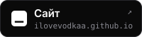</picture></a>

  

<picture>
  <source media="(prefers-color-scheme: dark)" srcset="assets/sections/stack-dark.svg">
  <source media="(prefers-color-scheme: light)" srcset="assets/sections/stack-light.svg">
  
</picture>

<picture>
  <source media="(prefers-color-scheme: dark)" srcset="assets/stack-dark.svg">
  <source media="(prefers-color-scheme: light)" srcset="assets/stack-light.svg">
  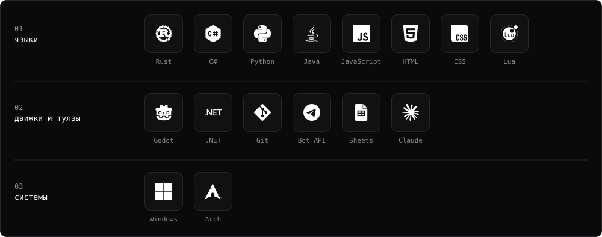
</picture>

  

<picture>
  <source media="(prefers-color-scheme: dark)" srcset="assets/sections/projects-dark.svg">
  <source media="(prefers-color-scheme: light)" srcset="assets/sections/projects-light.svg">
  
</picture>

<a href="https://github.com/ilovevodkaa/Telegradus"><picture><source media="(prefers-color-scheme: dark)" srcset="assets/gen/card-Telegradus-dark.svg"><source media="(prefers-color-scheme: light)" srcset="assets/gen/card-Telegradus-light.svg">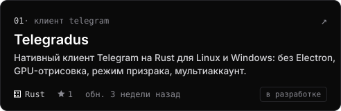</picture></a>
<a href="https://github.com/ilovevodkaa/Pax-Pixelia"><picture><source media="(prefers-color-scheme: dark)" srcset="assets/gen/card-Pax-Pixelia-dark.svg"><source media="(prefers-color-scheme: light)" srcset="assets/gen/card-Pax-Pixelia-light.svg">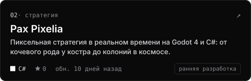</picture></a>
<a href="https://github.com/ilovevodkaa/Twilight-of-the-Union"><picture><source media="(prefers-color-scheme: dark)" srcset="assets/gen/card-Twilight-of-the-Union-dark.svg"><source media="(prefers-color-scheme: light)" srcset="assets/gen/card-Twilight-of-the-Union-light.svg">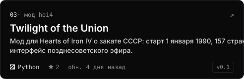</picture></a>
<a href="https://github.com/ilovevodkaa/margyt-screentime"><picture><source media="(prefers-color-scheme: dark)" srcset="assets/gen/card-margyt-screentime-dark.svg"><source media="(prefers-color-scheme: light)" srcset="assets/gen/card-margyt-screentime-light.svg">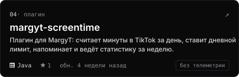</picture></a>

  

<picture>
  <source media="(prefers-color-scheme: dark)" srcset="assets/sections/now-dark.svg">
  <source media="(prefers-color-scheme: light)" srcset="assets/sections/now-light.svg">
  
</picture>

<a href="https://discord.com/users/848822433398259723"><picture><source media="(prefers-color-scheme: dark)" srcset="https://lanyard.cnrad.dev/api/848822433398259723?theme=dark&bg=0a0a0a&borderRadius=10px&hideBadges=true&hideTag=true&hideDecoration=true&idleMessage=%D1%81%D0%B5%D0%B9%D1%87%D0%B0%D1%81%20%D0%BD%D0%B8%D1%87%D0%B5%D0%B3%D0%BE%20%D0%BD%D0%B5%20%D0%B7%D0%B0%D0%BF%D1%83%D1%89%D0%B5%D0%BD%D0%BE"><source media="(prefers-color-scheme: light)" srcset="https://lanyard.cnrad.dev/api/848822433398259723?theme=light&bg=ffffff&borderRadius=10px&hideBadges=true&hideTag=true&hideDecoration=true&idleMessage=%D1%81%D0%B5%D0%B9%D1%87%D0%B0%D1%81%20%D0%BD%D0%B8%D1%87%D0%B5%D0%B3%D0%BE%20%D0%BD%D0%B5%20%D0%B7%D0%B0%D0%BF%D1%83%D1%89%D0%B5%D0%BD%D0%BE"></picture></a>

<picture>
  <source media="(prefers-color-scheme: dark)" srcset="assets/gen/activity-dark.svg">
  <source media="(prefers-color-scheme: light)" srcset="assets/gen/activity-light.svg">
  
</picture>

  

<picture>
  <source media="(prefers-color-scheme: dark)" srcset="assets/sections/stats-dark.svg">
  <source media="(prefers-color-scheme: light)" srcset="assets/sections/stats-light.svg">
  
</picture>

<picture>
  <source media="(prefers-color-scheme: dark)" srcset="assets/gen/stats-dark.svg">
  <source media="(prefers-color-scheme: light)" srcset="assets/gen/stats-light.svg">
  
</picture>

<picture>
  <source media="(prefers-color-scheme: dark)" srcset="https://raw.githubusercontent.com/ilovevodkaa/ilovevodkaa/output/github-snake-dark.svg">
  <source media="(prefers-color-scheme: light)" srcset="https://raw.githubusercontent.com/ilovevodkaa/ilovevodkaa/output/github-snake.svg">
  
</picture>

  

<picture>
  <source media="(prefers-color-scheme: dark)" srcset="assets/footer-dark.svg">
  <source media="(prefers-color-scheme: light)" srcset="assets/footer-light.svg">
  
</picture>

